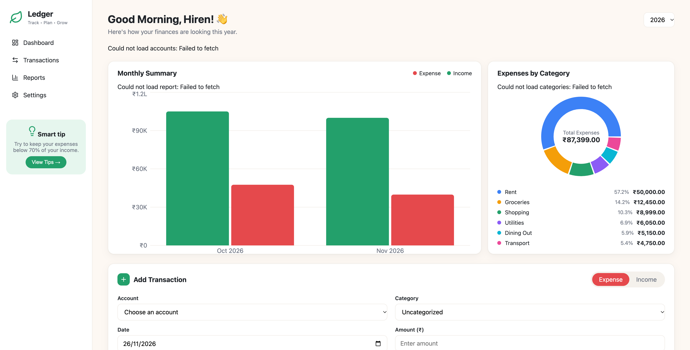
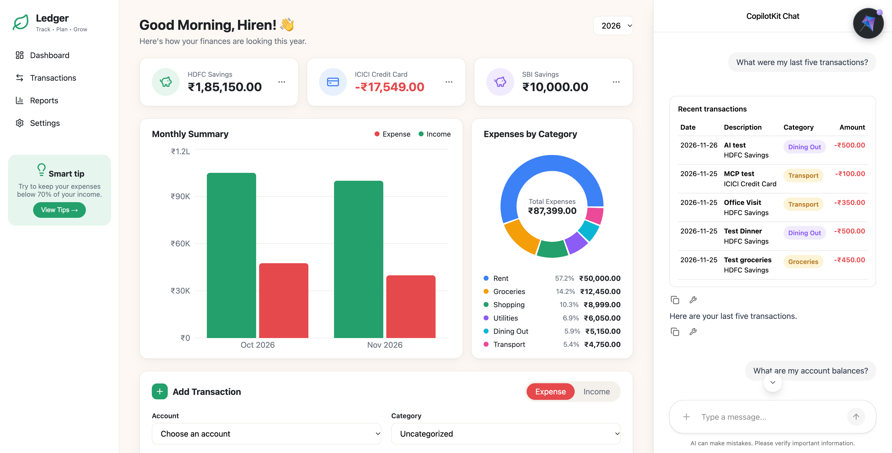
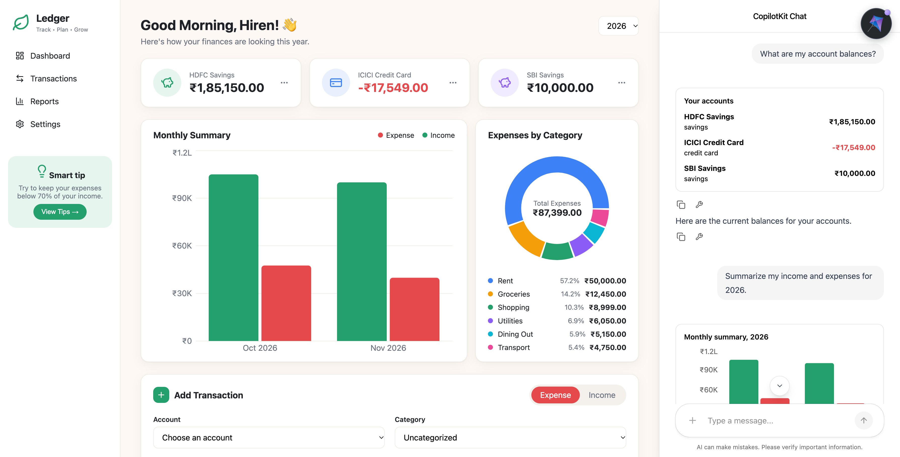
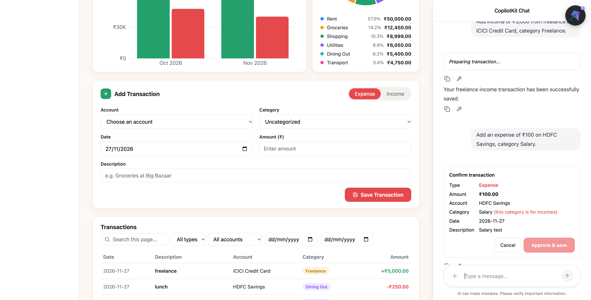
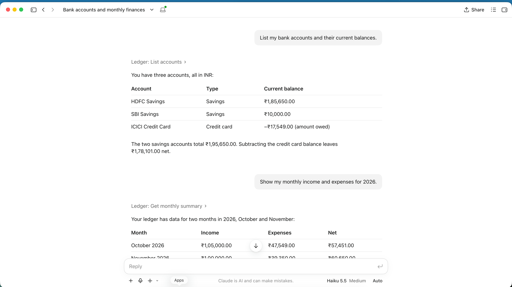

# Ledger: Personal Finance Tracker

A fullstack personal finance app for tracking bank accounts, income, and expenses. It includes a React dashboard, a REST API, an AI assistant that answers questions with live data, and an MCP server that lets desktop AI tools query the same ledger.

## Screenshots

### Dashboard


### Transactions



### AI assistant: tables and charts in chat
| Recent transactions | Monthly summary |
|---|---|
|  |  |

### AI assistant: approval before saving


### MCP Inspector


## Features

**Dashboard**
- Account balances calculated in SQL from the transaction history
- Monthly income vs. expense chart and expense breakdown by category
- Add income or expense transactions with validation on both the client and the server
- Transactions table with filters for type, account, and date range, plus pagination and a total count

**AI assistant (CopilotKit + Gemini)**
- Ask questions in plain language, such as "What were my last five transactions?"
- Answers appear as tables, account cards, and charts inside the chat, not as plain text
- Adding a transaction through chat shows an approval card. Nothing is saved until you click **Approve & save**
- The assistant can only report a transaction as saved after the save succeeds

**MCP server**
- Four tools (`list_accounts`, `list_transactions`, `get_monthly_summary`, `add_transaction`) for Claude Desktop and other MCP clients

## Tech Stack

- **Frontend:** React, TypeScript, Vite, TanStack Query, React Hook Form, Zod, Recharts, Lucide icons, CopilotKit
- **Backend:** Node.js, Express, MySQL 8, mysql2, Zod
- **AI:** Google Gemini via CopilotKit's agent runtime (AG-UI protocol)
- **Integration:** Model Context Protocol (MCP) SDK
- **Testing:** Vitest, Supertest

## Architecture

```
┌─────────────────────────── React app ───────────────────────────┐
│  Dashboard   Transactions table   Add form   CopilotKit chat     │
│                                            │  (renders tool      │
│                                            │   results as cards) │
└───────┬──────────────────────────────────────┬──────────────────┘
        │ REST (JSON)                          │ AG-UI (SSE)
        ▼                                      ▼
┌──────────────── Express server ─────────────────────────────┐
│  /api/accounts  /api/transactions  /api/reports  ...        │
│  /api/copilotkit  ──► Gemini agent ──► tools ──┐             │
│                                                 ▼             │
│                     Services (business rules, SQL) ◄──── MCP │
└────────────────────────────┬────────────────────────────────┘
                             ▼
                          MySQL 8
```

Routes handle HTTP and input validation. Services hold the business rules and SQL. The REST API, the assistant's tools, and the MCP server all use the same services, so every entry point follows the same rules.

**Approval flow for writes:** When the assistant wants to add a transaction, the browser shows a confirmation card. Your approval triggers the same `POST /api/transactions` endpoint as the form, so validation and business rules still apply.

## Getting Started

### Prerequisites

- Node.js 18.18 or newer
- MySQL 8 (MAMP works on macOS and Windows)
- A Google Gemini API key from [Google AI Studio](https://aistudio.google.com)

### 1. Set up the database

Create two databases, one for development and one for tests:

```sql
CREATE DATABASE ledger_app;
CREATE DATABASE ledger_app_test;
```

Create a database user with access to both, then load the schema and sample data into `ledger_app`:

```bash
mysql -u <user> -p ledger_app < server/sql/schema.sql
mysql -u <user> -p ledger_app < server/sql/seed.sql
```

### 2. Configure and start the API

```bash
cd server
cp .env.example .env    # then fill in your values
npm install
npm run dev             # http://localhost:4000
```

Set these values in `server/.env`:

| Variable | Purpose |
|---|---|
| `DB_HOST`, `DB_PORT`, `DB_USER`, `DB_PASSWORD`, `DB_NAME` | MySQL connection |
| `PORT` | API port, default `4000` |
| `GOOGLE_API_KEY` | Gemini API key. Never commit this file. |
| `GEMINI_MODEL` | Optional model override, such as `google/gemini-3.5-flash` |

Restart the server after changing `.env`.

### 3. Start the web app

```bash
cd client
npm install
npm run dev            # http://localhost:5173
```

Open http://localhost:5173. Use the chat panel on the right to talk to the assistant.

### 4. Optional: MCP server

```bash
cd server
npm run mcp
```

To connect Claude Desktop, add the server to `claude_desktop_config.json` using the full path to `server/src/mcp/ledger-mcp.js`.

## Running Tests

```bash
cd server
npm test
```

The tests run against `ledger_app_test` and reset the data before each test. They cover:
- Listing and filtering transactions, including the total count
- Creating transactions and updating balances
- Rejecting a category that doesn't match the transaction type
- Rejecting zero amounts and unknown accounts
- Monthly report totals

## API

| Method | Endpoint | Description |
|---|---|---|
| GET | `/api/health` | Health check |
| GET | `/api/accounts` | Accounts with current balances |
| POST | `/api/accounts` | Create an account |
| GET | `/api/transactions` | Paginated list with filters. Returns `{ items, total, page, limit }`. |
| POST | `/api/transactions` | Record a transaction |
| GET | `/api/categories` | All categories |
| GET | `/api/reports/monthly?year=` | Monthly income, expense, and net |
| GET | `/api/reports/categories?year=&kind=` | Totals by category |
| POST | `/api/copilotkit/*` | Assistant runtime (used by the chat panel) |

## Assistant Tools

The assistant can call these tools. Each one uses the same service functions as the REST API.

| Tool | Purpose | Shown in chat as |
|---|---|---|
| `list_accounts` | Lists accounts and balances | Account cards |
| `list_transactions` | Lists recent or filtered transactions | Transaction table |
| `get_monthly_summary` | Income and expense for each month | Bar chart |
| `get_category_breakdown` | Expense totals by category | Progress bars |
| `add_transaction` | Prepares a transaction for approval | Confirmation card with Approve and Cancel |

## Design Decisions

- **Money is stored as `DECIMAL(12,2)`**, never floating point, to avoid rounding errors.
- **Business rules live in the service layer.** The API, the assistant, and the MCP server all follow the same checks.
- **Parameterized queries throughout** prevent SQL injection.
- **Balances are calculated in SQL** from the transaction history, so they can't drift out of sync.
- **Writes from the assistant require approval.** An AI should never change financial records without a person confirming first.
- **Tool results are rendered as components,** not text, so amounts and tables always use the same formatting as the dashboard.

## Roadmap

- Edit and delete transactions
- Authentication with separate ledgers per user
- Monthly budget limits per category
- Pagination-aware search in the assistant

## License

MIT